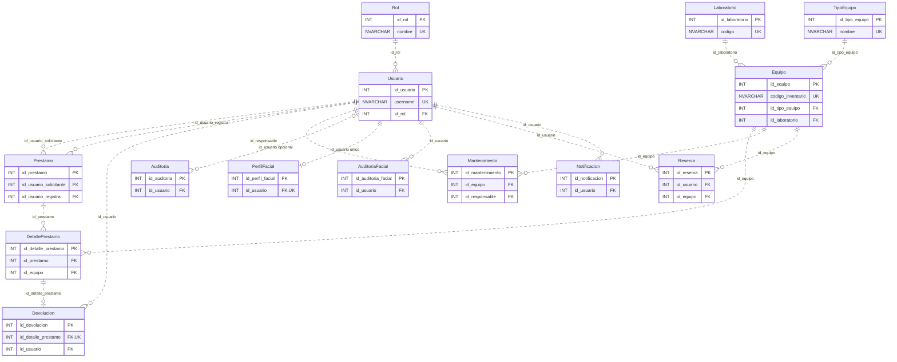

# SIGELAB — Modelo entidad-relación

## 1. Alcance y fuente

Este modelo documenta las **14 tablas y 17 claves foráneas** declaradas en [database/sigelab.sql](../database/sigelab.sql), dentro del esquema `dbo` de la base `SIGELAB`. Describe el esquema del script, no una inspección de una base de datos en ejecución.

- **Dominio mínimo oficial:** Rol, Usuario, Laboratorio, TipoEquipo, Equipo, Prestamo, DetallePrestamo, Devolucion, Mantenimiento y Auditoria.
- **Soporte de integración facial acordado:** PerfilFacial y AuditoriaFacial.
- **Extensiones aprobadas del equipo:** Reserva y Notificacion.

El diagrama muestra claves y columnas de enlace. Los tipos completos, el resto de columnas y las restricciones se detallan en el [diccionario de datos](DICCIONARIO_DATOS.md). Los acuerdos funcionales se mantienen en [TEAM_CONTRACT.md](TEAM_CONTRACT.md) y [DECISIONES.md](DECISIONES.md).

## 2. Diagrama

Las cardinalidades representan lo que permiten las FK, la nulabilidad y las restricciones `UNIQUE` del SQL actual. Una regla de negocio puede exigir condiciones adicionales, como confirmar un préstamo con al menos un detalle.

**Leyenda:** `PK` = clave primaria; `FK` = clave foránea; `UK` = columna con restricción de unicidad. `||` significa exactamente uno; `o|` (o `|o` en el extremo izquierdo), cero o uno; `o{`, cero o muchos. Las líneas discontinuas indican relaciones no identificadoras: la FK no forma parte de la PK de la tabla hija.

La unicidad de `(id_prestamo, id_equipo)` es **compuesta**: ninguna de las dos columnas es única individualmente.

## 3. Inventario de relaciones físicas

Cada fila corresponde a una FK del script. Los nombres de tablas de esta sección pertenecen al esquema `dbo`.

| Restricción | Columna de origen | Columna referenciada |
|---|---|---|
| `FK_Usuario_Rol` | `Usuario.id_rol` | `Rol.id_rol` |
| `FK_Equipo_TipoEquipo` | `Equipo.id_tipo_equipo` | `TipoEquipo.id_tipo_equipo` |
| `FK_Equipo_Laboratorio` | `Equipo.id_laboratorio` | `Laboratorio.id_laboratorio` |
| `FK_Prestamo_UsuarioSolicitante` | `Prestamo.id_usuario_solicitante` | `Usuario.id_usuario` |
| `FK_Prestamo_UsuarioRegistra` | `Prestamo.id_usuario_registra` | `Usuario.id_usuario` |
| `FK_DetallePrestamo_Prestamo` | `DetallePrestamo.id_prestamo` | `Prestamo.id_prestamo` |
| `FK_DetallePrestamo_Equipo` | `DetallePrestamo.id_equipo` | `Equipo.id_equipo` |
| `FK_Devolucion_DetallePrestamo` | `Devolucion.id_detalle_prestamo` | `DetallePrestamo.id_detalle_prestamo` |
| `FK_Devolucion_Usuario` | `Devolucion.id_usuario` | `Usuario.id_usuario` |
| `FK_Mantenimiento_Equipo` | `Mantenimiento.id_equipo` | `Equipo.id_equipo` |
| `FK_Mantenimiento_Responsable` | `Mantenimiento.id_responsable` | `Usuario.id_usuario` |
| `FK_Auditoria_Usuario` | `Auditoria.id_usuario` | `Usuario.id_usuario` |
| `FK_PerfilFacial_Usuario` | `PerfilFacial.id_usuario` | `Usuario.id_usuario` |
| `FK_AuditoriaFacial_Usuario` | `AuditoriaFacial.id_usuario` | `Usuario.id_usuario` |
| `FK_Reserva_Usuario` | `Reserva.id_usuario` | `Usuario.id_usuario` |
| `FK_Reserva_Equipo` | `Reserva.id_equipo` | `Equipo.id_equipo` |
| `FK_Notificacion_Usuario` | `Notificacion.id_usuario` | `Usuario.id_usuario` |

El script no declara `ON DELETE CASCADE` ni `ON UPDATE CASCADE`; las FK utilizan el comportamiento predeterminado `NO ACTION`. No debe interpretarse ninguna relación como autorización para eliminar historial.

## 4. Cardinalidades y límites importantes

- **Préstamo y detalle:** un detalle pertenece a un préstamo y a un equipo. El SQL permite un encabezado sin detalles; exigir al menos un equipo al confirmar es responsabilidad de `Service` (RN-05). La combinación única de préstamo/equipo respalda RN-06 sin impedir préstamos históricos del mismo equipo.
- **Devolución:** cada devolución corresponde a un único detalle; un detalle puede no tener devolución o tener una sola. La FK con `UNIQUE` impide registrar una segunda devolución del mismo detalle y permite representar devoluciones parciales. El cierre del préstamo cuando no quedan pendientes debe validarse en `Service` (RN-11 y RN-16).
- **Auditoría:** `Auditoria.id_usuario` permite `NULL`. Un evento puede no estar asociado a un usuario identificado; cuando se informa un ID, debe existir en `Usuario`.
- **Perfil facial — discrepancia documental pendiente de coordinación:** el plano técnico del equipo, §6.13, expresa `Usuario 1:1 PerfilFacial`. El SQL garantiza como máximo un perfil por usuario, pero no obliga a que cada usuario tenga uno: físicamente es `Usuario 1 → 0..1 PerfilFacial`. Este documento refleja esa diferencia, sin modificar ni dar por corregido el contrato. Debe revisarse con los responsables de usuarios y facial (#2 y #8). La opcionalidad en almacenamiento no elimina la validación facial obligatoria del login final.
- **Referencias genéricas:** `Auditoria.entidad/id_registro` y `Notificacion.entidad/id_referencia` no tienen FK hacia otras entidades. No se dibujan como relaciones físicas adicionales.
- **Reservas:** las fechas pertenecen a una reserva de un usuario y un equipo. El `CHECK` valida su orden, pero no impide solapamientos entre filas ni cambia el estado del equipo.

## 5. Separación entre integridad SQL y negocio

El esquema aporta PK, FK, `UNIQUE`, `NOT NULL`, `CHECK` y algunos valores predeterminados. No implementa por sí solo disponibilidad, permisos, transiciones de estado, préstamos vencidos, solapamiento de reservas ni atomicidad de operaciones con auditoría.

Esas validaciones y transacciones deben respetar [TEAM_CONTRACT.md](TEAM_CONTRACT.md), §§4, 9–12, y las reglas oficiales. Este diagrama no acredita que los servicios o las pruebas funcionales estén terminados.
